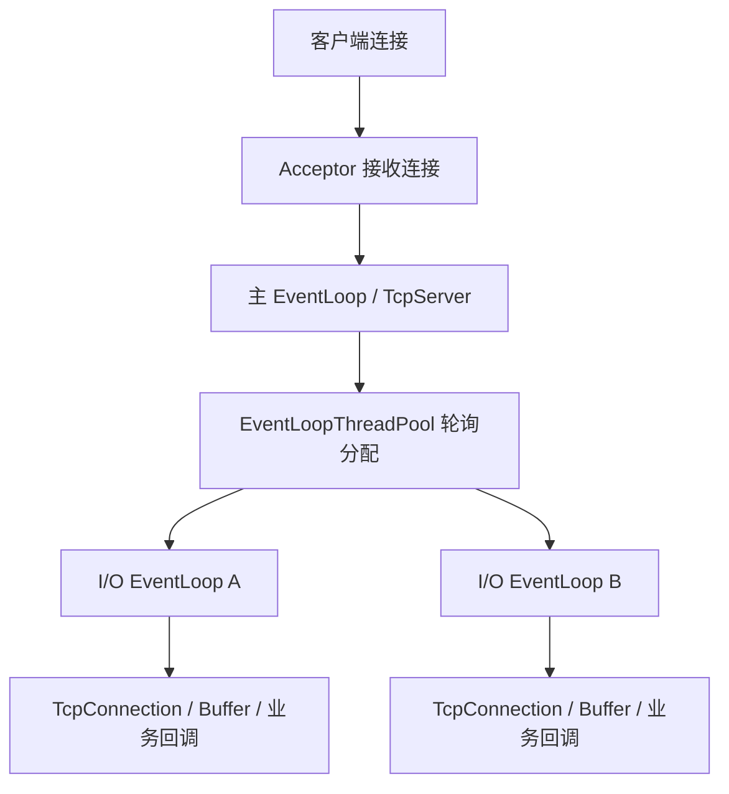

# ReactorNet

围绕 **Reactor 事件驱动、非阻塞 TCP 通信和 one loop per thread 线程模型**，研究 Linux 网络服务端的设计与实现。

当前仓库包含基础组件、网络核心。

> 当前代码依赖 Linux/POSIX 接口。在 Windows 上开发时，可使用WSL2。

## 核心能力

| 方向 | 当前代码中的实现 |
| --- | --- |
| 事件驱动 | `EventLoop` 组织事件循环，`Channel` 分发文件描述符事件，`Poller` 封装 I/O 多路复用 |
| I/O 后端 | 默认使用 `epoll`，同时提供 `poll` 实现 |
| TCP 通信 | `TcpServer`、`TcpClient`、连接管理、非阻塞读写以及 IPv4/IPv6 地址封装 |
| 多线程 I/O | 每个 I/O 线程运行自己的 `EventLoop`，新连接默认以轮询方式分配 |
| 跨线程任务 | 通过任务队列投递回调，使用 `eventfd` 唤醒目标事件循环 |
| 数据缓冲 | 输入/输出缓冲区、`readv` 分散读、发送剩余数据缓存和高水位回调 |
| 定时任务 | 基于 `timerfd` 与按到期时间排序的集合，支持单次、周期任务及取消 |
| 基础组件 | 线程、线程池、互斥锁、条件变量、阻塞队列、时间与文件工具 |
| 日志 | 流式日志、日志文件滚动，以及后台线程批量写入的异步日志组件 |
| 扩展模块 | 基础 HTTP 服务、运行状态检查、Protobuf 编解码与 RPC 相关实现 |

TCP 提供字节流传输，应用协议仍需自行处理消息边界。`Buffer` 提供缓冲能力，不会自动完成任意协议的拆包、组包。

## 架构与执行流程



配置多个 I/O 线程时，主事件循环接收新连接，随后将连接交给选定的 I/O 事件循环。连接上的读写事件由所属事件循环串行处理。

`TcpServer::setThreadNum(0)` 为默认的单线程模式，此时接收连接和网络 I/O 都在主事件循环中完成。

一次消息接收的大致调用链为：

```text
EventLoop::loop()
  └─ Poller::poll() 等待就绪事件
      └─ Channel::handleEvent() 分发事件
          └─ TcpConnection::handleRead() 读取到输入缓冲区
              └─ messageCallback() 处理业务数据
```

使用时应避免在 I/O 回调中执行耗时计算或阻塞操作，否则会影响同一事件循环上的其他连接。此类工作可以交给独立的业务线程池，再将结果投递回连接所属的事件循环。


## 构建核心库

### 环境要求

- Linux，或 Windows 下的 WSL Linux 环境。
- 支持 C++11 的 GCC。
- **CMake 4.0 或以上**，这是当前顶层 `CMakeLists.txt` 声明的最低版本。
- Make 或 Ninja 等构建工具。
- Boost 开发头文件，当前构建脚本通过 `find_package(Boost REQUIRED)` 查找。

Protobuf、Zlib、Boost.Test 等依赖用于对应的扩展模块或测试。构建核心库时不需要启用所有扩展模块。

